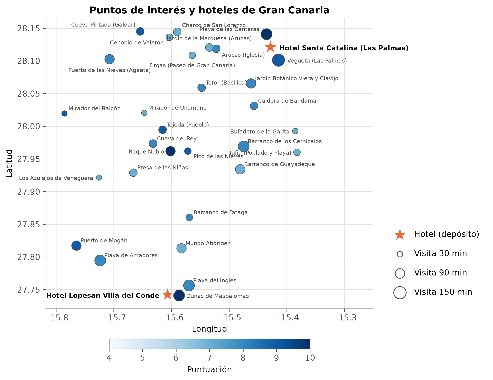
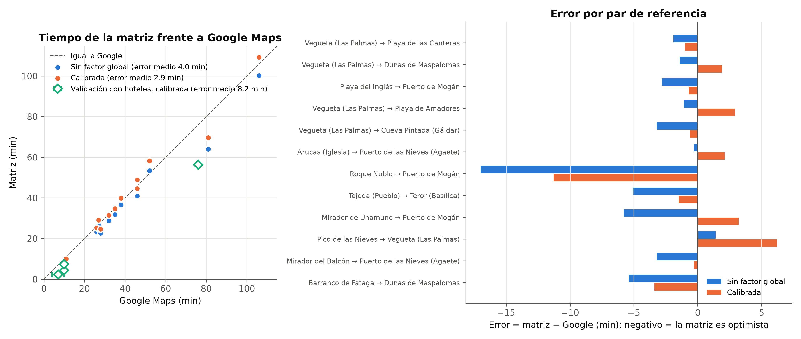
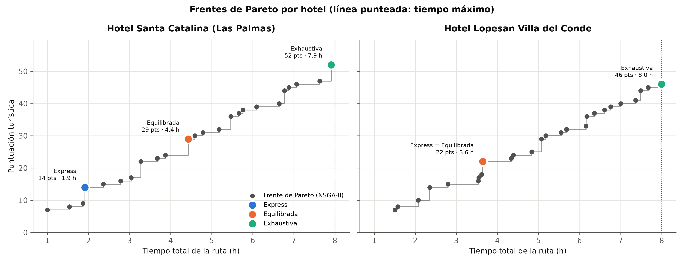

# Memoria: datos, matriz de tiempos y modelo

Secciones de la memoria correspondientes a la parte de datos y visualización. Todas las cifras salen de los ficheros del repositorio y se pueden regenerar con `python main.py`, `python scripts/make_figures.py` y `python -m src.benchmarks.statistical_suite`.

---

## 1. Origen de los datos y licencia

El caso de estudio tiene **30 puntos de interés (POIs)** de Gran Canaria y **2 hoteles** que sirven de base de salida y regreso. Cada POI tiene nombre, coordenadas, una puntuación turística (0–10) y un tiempo de visita en minutos.

| Dato | Fuente | Licencia / uso |
|---|---|---|
| Red de carreteras | OpenStreetMap, descargada con OSMnx | © colaboradores de OpenStreetMap, **ODbL 1.0** |
| Coordenadas de los hoteles | Google Maps, consulta manual | Solo se guardan coordenadas puntuales |
| Coordenadas de los POIs | Recopiladas manualmente por el equipo; el notebook comprueba que caen dentro de la isla | Datos propios |
| Tiempos de referencia: 12 pares para calibrar y 4 para validar | Google Maps, consulta manual (los de calibración, en día laborable a media mañana) | Muestra pequeña usada para ajustar y comprobar un factor; no se redistribuyen datos de Google |
| Puntuaciones y tiempos de visita | Propuestos con un asistente de IA y revisados por el equipo (ver sección 5) | Valores ilustrativos propios |

**Sobre la ODbL.** La matriz de tiempos se deriva de la base de datos de OpenStreetMap. Si se publica, debe atribuirse ("© colaboradores de OpenStreetMap") y distribuirse con la misma licencia ODbL. Los mapas interactivos usan las teselas de OpenStreetMap, que ya muestran esa atribución.

**Limitación de las puntuaciones.** Las puntuaciones y los tiempos de visita no proceden de una fuente medible, como el número de reseñas o encuestas. Reflejan un criterio razonable pero subjetivo, y otro criterio cambiaría el frente de Pareto y las rutas recomendadas. El modelo favorece los lugares con mucha puntuación por minuto de visita. Por ejemplo, Tufia (7 puntos en 45 min) aparece en casi todas las rutas y las Dunas de Maspalomas (10 puntos en 120 min) en ninguna, aunque estén a minutos del hotel Lopesan.

---

## 2. Construcción de la matriz de tiempos

La matriz se genera con `scripts/build_time_matrix.ipynb`, ejecutable en Google Colab, en cinco pasos:

1. **Grafo viario.** Se descarga la red conducible de la isla (`ox.graph_from_place("Gran Canaria, Spain", network_type="drive")`). Solo se conserva la **mayor componente fuertemente conexa**, de modo que desde cualquier nodo se puede llegar a cualquier otro respetando los sentidos únicos. Así no aparecen tiempos infinitos.
2. **Velocidades.** `ox.add_edge_speeds` asigna a cada tramo su velocidad máxima (etiqueta `maxspeed`) o, si falta, la media de su tipo de vía. Con la longitud del tramo se obtiene su tiempo de recorrido.
3. **Penalización por curvas.** A plena velocidad legal, las carreteras de montaña salen demasiado rápidas. Para cada tramo se mide la curvatura (grados girados por kilómetro) y se reduce la velocidad: $v_{\text{efectiva}} = v_{\text{límite}} / (1 + \text{curvatura}/K)$, con un suelo de 15 km/h. $K$ se elige entre varios candidatos comparando con Google Maps, y solo se activa si reduce el error medio al menos 0,5 min.
4. **Asociación a la red.** Cada POI y cada hotel se asocia al nodo de carretera más cercano (`ox.distance.nearest_nodes`). Se avisa si alguno queda a más de 300 m de la carretera o si dos puntos comparten nodo.
5. **Caminos mínimos.** Se ejecuta un Dijkstra por origen (32 ejecuciones en lugar de 32² consultas) y se obtiene una matriz $32 \times 32$ en minutos (30 POIs y 2 hoteles). El notebook comprueba que no queden `inf` ni `NaN`.

La matriz es **asimétrica**: la diferencia máxima entre $t_{ij}$ y $t_{ji}$ es de 5,2 min, debida a calles de sentido único y accesos distintos. Los tiempos fuera de la diagonal van de 2,2 a 132 min, con mediana de 53,6 min.

Para cada hotel se exporta un conjunto de 31 nodos (los 30 POIs y ese hotel) en `data/<hotel>/`: `matriz_tiempos.csv`, `puntos_interes.csv` y `coordenadas.csv`. La matriz completa y la matriz antes del factor global se guardan en `data/auxiliar/`.

---

## 3. Calibración con Google Maps y limitaciones

Los tiempos de OSMnx son optimistas porque suponen circulación a la velocidad de la vía, sin tráfico, semáforos ni aparcamiento. Para corregirlo se midieron en Google Maps **12 pares de POIs** repartidos entre trayectos urbanos, autopista GC-1 y montaña. Tras la penalización por curvas, se aplica a toda la matriz (hoteles incluidos) un **factor global** ajustado por mínimos cuadrados por el origen:

$$f = \frac{\sum_k m_k\, g_k}{\sum_k m_k^2} = 1{,}09$$

donde $m_k$ es el tiempo del modelo y $g_k$ el de Google para el par $k$. Los ratios $g_k/m_k$ apenas varían (coeficiente de variación 0,08), así que un único factor es razonable.

| | Error medio absoluto |
|---|---|
| Matriz sin factor global (con penalización por curvas) | 4,0 min |
| Matriz calibrada (12 pares de calibración) | **2,9 min** |
| Matriz calibrada (4 pares de validación con hotel, no usados para ajustar) | 8,2 min |

"Sin factor global" no significa sin ninguna corrección. La penalización por curvas ya está aplicada en ambas matrices y no se puede separar con los datos guardados. Los datos de la tabla están en `output/figuras/calibracion_google.csv` y `validacion_hoteles.csv`.

**Validación fuera de muestra.** Después de construir la matriz se midieron cuatro pares con hotel:

| Par | Matriz (min) | Google Maps (min) |
|---|---|---|
| Lopesan → Dunas de Maspalomas | 2,3 | 4–10 (según el acceso) |
| Lopesan → Roque Nublo | 56,3 | 76 |
| Santa Catalina → Vegueta | 4,3 | 10 |
| Vegueta → Santa Catalina | 7,3 | 10 |

La matriz es optimista en los cuatro casos. El error de validación (8,2 min) es casi el triple que el de calibración, lo esperable cuando se evalúa con datos que no se usaron para ajustar.

**Limitaciones.** Los tiempos son **aproximados** y conviene leerlos como estimaciones:

- **Montaña.** Es el mayor error: Lopesan → Roque Nublo sale 20 min corto (−26 %) y Roque Nublo → Puerto de Mogán 11 min corto, incluso después de calibrar. Un único factor global no basta para las carreteras sinuosas de la cumbre.
- **Ciudad.** En trayectos urbanos cortos pesan semáforos, tráfico y aparcamiento, que el modelo no incluye. Santa Catalina → Vegueta da 4,3 min frente a 10 min en Google.
- **Acceso a las playas.** La posición del POI es un punto, pero llegar a las Dunas desde el hotel tarda de 4 a 10 min según el acceso.
- **Carreteras cortadas.** La red refleja los cortes de carretera actuales. Por eso Presa de las Niñas → Tejeda tarda 132 min: el camino mínimo rodea por Mogán. El tiempo es correcto con esos cortes, pero si se reabren las carreteras habría que regenerar la matriz. Este POI no aparece en ninguna ruta del frente.
- **Tráfico.** No se modela variación horaria; los tiempos de referencia corresponden a un día laborable a media mañana.

En consecuencia, las rutas que suben a la cumbre desde el sur o que encadenan tramos urbanos durarán en la realidad algo más que lo calculado. Una mejora natural sería usar factores distintos por tipo de trayecto (urbano, autopista, montaña) o una API de rutas con tráfico.

---

## 4. Modelo de ruta cerrada con dos hoteles

### Formulación

Se resuelve un **problema de orientación multiobjetivo** (*Multi-Objective Orienteering Problem*) por cada hotel. Sea $h$ el hotel (depósito), $P$ el conjunto de 30 POIs, $s_i$ la puntuación y $v_i$ el tiempo de visita del POI $i$, y $t_{ij}$ el tiempo de conducción de la matriz. Una solución es una secuencia ordenada de POIs distintos $R = (r_1, \dots, r_k)$, $r_j \in P$, que forma una **ruta cerrada** $h \to r_1 \to \dots \to r_k \to h$:

$$\max\; S(R) = \sum_{j=1}^{k} s_{r_j}$$

$$\min\; T(R) = t_{h r_1} + \sum_{j=1}^{k-1} t_{r_j r_{j+1}} + t_{r_k h} + \sum_{j=1}^{k} v_{r_j}$$

$$\text{s.a.}\quad T(R) \le T_{\max} = 480 \text{ min}, \qquad r_j \ne r_l \;\; \forall j \ne l$$

- **La salida y la llegada son el mismo hotel**, así que el tiempo incluye el regreso. El hotel tiene puntuación 0 y visita 0, y no puede elegirse como parada.
- **El orden importa**: la matriz es asimétrica, de modo que la misma lista de POIs en otro orden puede durar más.
- **No hace falta visitar todos los POIs**: la longitud de la ruta es variable y cada individuo de NSGA-II es una lista de longitud variable.
- **Restricción de tiempo**: se trata con las reglas de Deb. Una solución factible domina a cualquier no factible, y entre dos no factibles domina la de menor exceso $\max(0, T - T_{\max})$. Así no hace falta penalizar la función objetivo.

### Dos hoteles, dos escenarios

Los hoteles representan dos perfiles de turista: **Santa Catalina** en Las Palmas (norte) y **Lopesan Villa del Conde** en Meloneras (sur). No es un problema con varios depósitos: cada hotel define una instancia independiente de 31 nodos (`data/santa_catalina/` y `data/lopesan_villa_del_conde/`), y `main.py` los resuelve por separado (`--escenario` elige uno). Al compartir POIs, puntuaciones y calibración, las diferencias entre escenarios solo se deben a la posición del hotel.

### Resultados

De cada frente de Pareto se extraen tres rutas recomendadas: **Express** (máxima puntuación por hora), **Equilibrada** (punto rodilla, el más cercano al ideal normalizado) y **Exhaustiva** (máxima puntuación dentro de las 8 h).

| Hotel | Ruta | Puntuación | Tiempo | Paradas |
|---|---|---|---|---|
| Santa Catalina | Express | 14 | 1,9 h | Tufia, Bufadero de la Garita |
| | Equilibrada | 29 | 4,4 h | Arucas, Firgas, Tufia, Bufadero |
| | Exhaustiva | 52 | 7,9 h | Cueva Pintada, Cenobio de Valerón, Firgas, Jardín de la Marquesa, Arucas, Tufia, Bufadero |
| Lopesan | Express = Equilibrada | 22 | 3,6 h | Tufia, Bufadero de la Garita, Barranco de Fataga |
| | Exhaustiva | 46 | 8,0 h | Tufia, Bufadero, Cueva Pintada, Firgas, Arucas, Barranco de Fataga |

- **El hotel del sur pierde valor.** Desde Lopesan el frente alcanza menos puntuación (46 frente a 52) y menor hipervolumen (10.013 frente a 11.594), porque la mayoría de los POIs están en el norte y en la cumbre, y las playas cercanas tienen visitas largas.
- **En Lopesan, Express y Equilibrada coinciden**: la ruta con mejor puntuación por hora es también el punto rodilla.
- **Las rutas se ven en mapas interactivos** (`output/<hotel>/mapa_rutas.html`, generados con `scripts/make_maps.py`). Cada ruta es una capa con las paradas numeradas y un popup con la puntuación, el tiempo de visita y la hora de llegada. Los tramos se dibujan como **líneas rectas** entre paradas y no siguen la carretera; para trazar el recorrido real habría que guardar los caminos de OSMnx.

---

## 5. Uso de inteligencia artificial

Se han usado asistentes de IA en las siguientes tareas, siempre con revisión del equipo:

1. **Puntuaciones y tiempos de visita de los POIs.** Un asistente de IA propuso la puntuación (0–10) y el tiempo de visita de cada POI a partir de su interés turístico general, y el equipo los revisó a mano. No proceden de una fuente medible y se tratan como datos ilustrativos (sección 1).
2. **Integración y revisión del código** (Claude Code, Anthropic). Se usó para revisar los cambios del repositorio y fusionar la rama de datos de los hoteles con la de los algoritmos. Detectó dos errores que se corrigieron: un `import` que impedía ejecutar la batería estadística y un presupuesto de 20.000 evaluaciones en Weighted Sum en lugar de 20.100. Cada cambio se comprobó ejecutando el código: el número de evaluaciones se contó durante la ejecución y la reproducibilidad se verificó repitiendo la ejecución con la misma semilla.
3. **Visualización** (Claude Code). Generó los scripts `scripts/make_maps.py` (mapas Folium) y `scripts/make_figures.py` (figuras de esta memoria). Las figuras se revisaron visualmente y las cifras se contrastaron con los CSV y JSON de resultados.
4. **Redacción** (Claude Code). Redactó el borrador de estas secciones y de la documentación de los datos (`data/README.md`) a partir de los resultados del repositorio. El equipo revisó el contenido.

La IA **no** se usó para obtener los tiempos de conducción. Estos proceden de OpenStreetMap y de las mediciones manuales en Google Maps descritas en las secciones 2 y 3.

> **Nota para el equipo:** completad esta lista con cualquier otro uso de IA en el resto del proyecto, por ejemplo en el desarrollo del notebook o de los algoritmos, antes de entregar.
